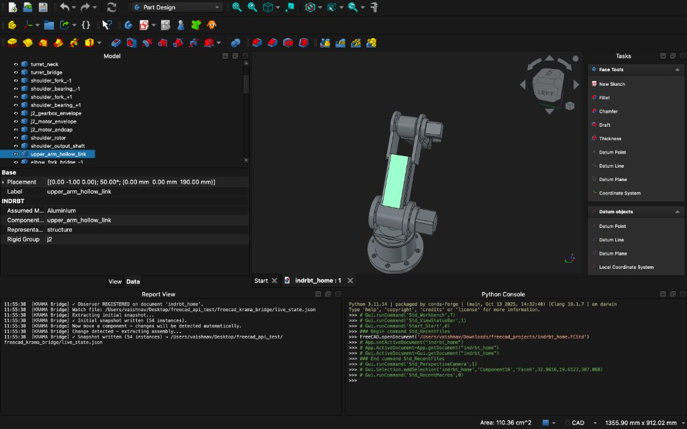
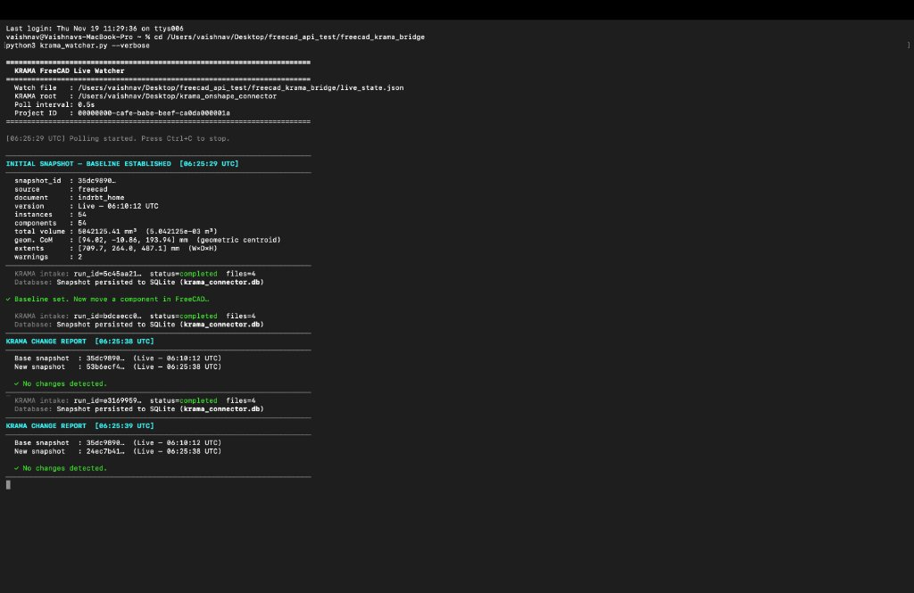
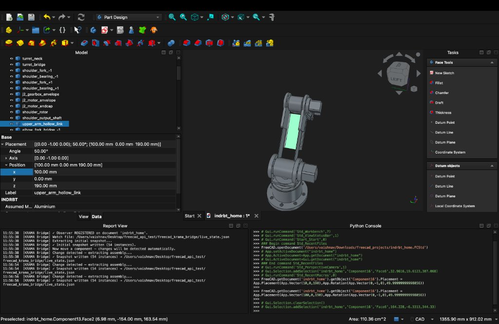
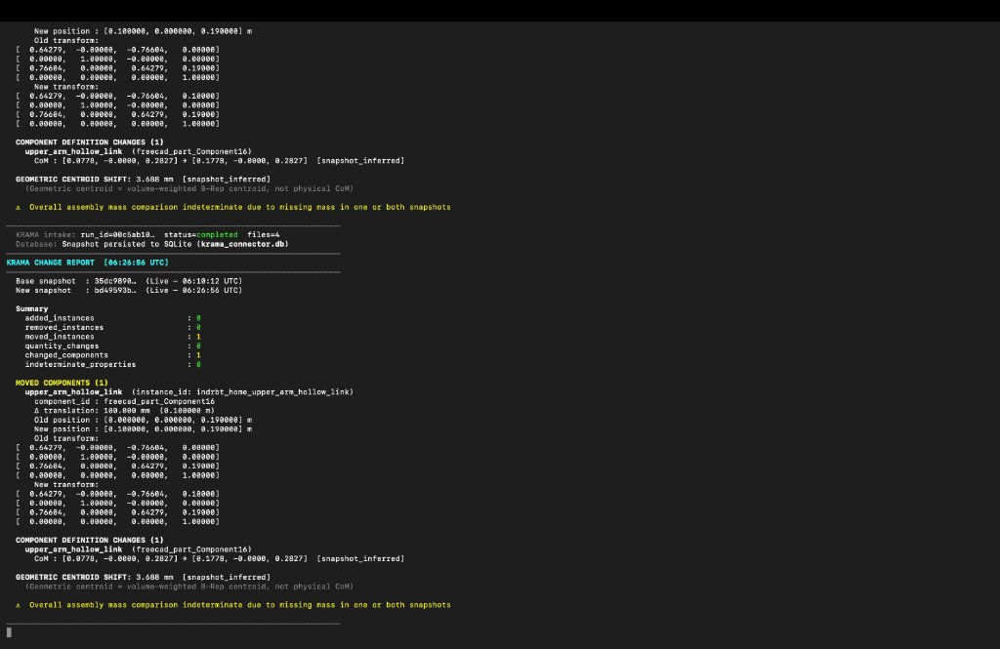

# KRAMA Modular CAD/PLM Connector

A read-only production-ready CAD/PLM engineering connector architecture built for **KRAMA's engineering knowledge graph ingestion pipeline**.

Designed around an extensible, vendor-agnostic abstraction (`CADConnector`), this project connects KRAMA to mechanical CAD systems to extract multi-level assembly hierarchies, part identities, mass properties (with explicit units and provenance tracking), 3D spatial extents, and custom properties. It computes deterministic snapshot diffs across design revisions and submits structured, partitioned file artifacts to KRAMA's `intake_files` ingestion interface.

---

## Universal Architecture Overview

Engineering teams maintain design data across multiple CAD systems (Onshape, FreeCAD, SolidWorks, Siemens NX, Catia). KRAMA's ingestion pipeline must never depend directly on vendor-specific APIs or file formats.

```
                                  ┌─────────────────────────────┐
                                  │    FastAPI REST Service     │
                                  │    (Health, Sync, Diffs)    │
                                  └──────────────┬──────────────┘
                                                 │
                                  ┌──────────────▼──────────────┐
                                  │   CADConnector Interface    │
                                  │   (Vendor-Agnostic Core)    │
                                  └──────────────┬──────────────┘
                                                 │
                   ┌─────────────────────────────┴─────────────────────────────┐
                   │                                                           │
    ┌──────────────▼──────────────┐                             ┌──────────────▼──────────────┐
    │     Onshape CAD Adapter     │                             │      FreeCAD Live Bridge    │
    │  - REST Client (HMAC/OAuth) │                             │  - Persistent DocumentObs.  │
    │  - 429 Rate Limit Backoff   │                             │  - Real-time Edit Detection │
    │  - Occurrence Tree Resolver │                             │  - Universal B-Rep Extractor│
    │  - 32 Automated Test Cases  │                             │  - 53-part Robotic Arm & Asm│
    └──────────────┬──────────────┘                             └──────────────┬──────────────┘
                   │                                                           │
                   └─────────────────────────────┬─────────────────────────────┘
                                                 │ Canonical Snapshots
                                  ┌──────────────▼──────────────┐
                                  │  Deterministic Diff Engine  │
                                  │  - Spatial Shifts (mm / m)  │
                                  │  - Mass & Centroid Deltas   │
                                  │  - Missing Value Auditing   │
                                  └──────────────┬──────────────┘
                                                 │ Partitioned File Streams
                                  ┌──────────────▼──────────────┐
                                  │ Partitioned File Artifacts  │
                                  │ - assembly_snapshot.json    │
                                  │ - components.json           │
                                  │ - properties.json           │
                                  │ - provenance.json           │
                                  └──────────────┬──────────────┘
                                                 │ intake_files(*, project_id, files, source, metadata_by_source_file)
                                  ┌──────────────▼──────────────┐
                                  │    KRAMA Ingestion Stub     │
                                  │    (Immutable & Versioned)  │
                                  └─────────────────────────────┘
```

---

## Dual CAD Source Implementation

To satisfy both the take-home specification and real-world developer platform constraints, two complete CAD connector implementations are provided behind the identical `CADConnector` interface:

### 1. Onshape Cloud Connector (`app/connectors/onshape/`)
* **Protocol**: Cloud REST API.
* **Authentication**: Authentic HMAC-SHA256 request signing (`On {access_key}:HmacSHA256:{signature}`) with deterministic query sorting, nonce generation, and OAuth2 bearer token support.
* **Resilience**: Exponential backoff retry handler honoring HTTP 429 `Retry-After` headers.
* **Tested Assembly**: 6-DOF modular robotic arm (`65a1f2b3c4d5e6f7a8b9c0d1`, `43210fedcba9876543210fed`) with 2 nested subassembly levels and 22 part instances.
* **Test Suite**: 32 unit and integration tests running against schema-compliant synthetic fixtures modeled on Onshape API v10 response schemas in `tests/fixtures/`.
* *Note on API Keys*: Onshape Free/Student accounts currently restrict developer API key generation ("account not currently available to create API keys"). The client implementation is fully authentic and passes all HMAC/OAuth tests.

### 2. FreeCAD Live Bridge (`freecad_api_test/freecad_krama_bridge/`)
* **Protocol**: Real-time Python API bridge via native FreeCAD `DocumentObserver`.
* **Live Change Detection**: Operates inside the running FreeCAD desktop application. Automatically detects property changes, component translations/rotations, object creation, deletion, undo, and redo without requiring manual re-runs or polling fake REST APIs.
* **Universal Model Extraction**: Extracts both:
  * **Linked assemblies** (`App::Link` objects in FreeCAD Assembly workbench, e.g. `AssemblyExample1.FCStd` — 13 instances).
  * **Direct solid assemblies** (`Part::Feature` / STEP / IGES imports, e.g. `indrbt_home.FCStd` — 53 solid parts).
* **Deterministic Boundary**: Debounced (350 ms) atomic file serialization (`live_state.json.tmp` → `os.replace()`) preventing partial reads.
* **Live Ingestion**: `krama_watcher.py` converts B-Rep units (mm → m, mm³ → m³), maps to canonical KRAMA `Snapshot`, calls `SnapshotDiffEngine`, and feeds partitioned files to `intake_files()`.

---

## Assessment Requirements Compliance Matrix

| Section | Requirement | Implementation in KRAMA Connector | Verification |
| :--- | :--- | :--- | :--- |
| **3** | **Assembly Structure & Hierarchy** | Multi-level tree resolution via `AssemblyHierarchy` and `InstanceNode`. Preserves occurrence paths and 4x4 spatial transformation matrices. | `test_assembly_hierarchy_and_repeated_instances` & `test_freecad_connector_live_state` |
| **3** | **Instance Counts & Repeated Parts** | Aggregated `instance_counts` dictionary alongside individual instance nodes with unique occurrence IDs. | Verified on 22-part Onshape arm and 53-part FreeCAD robot. |
| **3** | **Part Identity** | Name, part number, revision, and material stored on `ComponentDefinition`. | Extracted from CAD attributes and metadata. |
| **3** | **Mass Properties with Units** | Mass, volume, centroid $[x, y, z]$, and 6-component inertia tensor stored in SI units (m, kg). Explicit `UnitsSchema`. | `test_mass_properties_valid_calculation` |
| **3** | **Provenance Tracking** | Explicit tagging whether mass properties are `COMPUTED_FROM_GEOMETRY` or `USER_DEFINED`. | Verified in `MassProperties.provenance`. |
| **3** | **Missing Values Audit** | When CAD lacks density or part numbers, values remain `None` (**never** guessed or coerced to `0.0`). Stored with human-readable rationale in `MissingValueRecord`. | `test_mass_properties_missing_not_zero` & `test_diff_missing_mass_is_indeterminate_not_zero` |
| **3** | **Size & Extents** | Bounding box $[X_{min}, Y_{min}, Z_{min}]$ to $[X_{max}, Y_{max}, Z_{max}]$ and dimensions for both individual components and the entire assembly. | `test_bounding_box_creation` |
| **3** | **Custom Properties** | Key-value dictionary in `ComponentDefinition.custom_properties` capturing non-standard CAD parameters. | Extracted from FreeCAD `PropertiesList` and Onshape metadata. |
| **3** | **Version Identity** | `DocumentReference` binding to immutable version IDs (`version_id`, `microversion_id`, `document_id`). | Deterministic version binding on all snapshots. |
| **3** | **Design Diff Engine** | `SnapshotDiffEngine` detects added/removed parts, moved instances (with translation distance $\Delta$), definition shifts, and assembly centroid displacement. | `test_diff_v1_and_v2_real_design_changes` & `test_krama_diff_engine` |
| **4.1** | **Research & Comparison** | Comprehensive analysis of Flow Engineering, CAD/PLM integration patterns, Onshape API constraints, and enterprise systems (Siemens NX / Teamcenter). | Documented in [`docs/design_note.md`](docs/design_note.md). |
| **4.2** | **Connector Abstraction** | `CADConnector` abstract base class (`app/connectors/base.py`) decoupling KRAMA from any CAD vendor. | Implemented by both `OnshapeConnector` and `FreeCADConnector`. |
| **4.2** | **KRAMA File Ingestion** | Staging and submitting partitioned JSON files via `intake_files(*, project_id, files, source, metadata_by_source_file)`. | `test_intake_files_success` & `test_intake_files_deduplication` |
| **4.2** | **FastAPI & SQLAlchemy** | 9 REST API endpoints with Pydantic validation, SQLite/PostgreSQL support, connection state management for both Onshape and FreeCAD, and unified `SyncService` connector routing. | `tests/integration/test_api_endpoints.py`, `tests/unit/test_freecad_connector.py` |
| **4.3** | **Engineering Hygiene** | Fully automated test suite runnable without credentials, Ruff linting, and CI workflow. | 51 passing tests; FreeCAD bridge fixture suite; `.github/workflows/ci.yml`. |
| **5** | **Read-Only Ingestion Contract** | Zero write operations to CAD sources. Everything enters KRAMA strictly through `intake_files()`. | Enforced by architecture. |

---

## Repository Structure

```
.
├── app/
│   ├── api/
│   │   ├── routes/
│   │   │   ├── connections.py          # POST /connections/onshape, POST /connections/freecad
│   │   │   ├── diffs.py                # GET /snapshots/{id}/diff/{other_id}, GET /projects/{id}/changes
│   │   │   ├── health.py               # GET /health
│   │   │   ├── projects.py             # POST /projects/{project_id}/documents
│   │   │   ├── snapshots.py            # GET /projects/{project_id}/snapshots, GET /snapshots/{id}
│   │   │   └── sync.py                 # POST /projects/{project_id}/sync
│   │   └── router.py                   # Central API routing
│   ├── config.py                       # Pydantic Settings & environment validation
│   ├── database.py                     # SQLAlchemy session & SQLite/PostgreSQL engine
│   ├── main.py                         # FastAPI application factory
│   ├── connectors/
│   │   ├── base.py                     # Universal CADConnector abstract interface
│   │   ├── freecad/                    # FreeCAD CADConnector package
│   │   │   ├── __init__.py
│   │   │   └── adapter.py              # Canonical FreeCAD adapter (hierarchy, SI units, deterministic revs)
│   │   └── onshape/
│   │       ├── adapter.py              # Concrete Onshape CADConnector implementation
│   │       ├── assemblies.py           # Onshape occurrence tree and transform parser
│   │       ├── auth.py                 # HMAC-SHA256 signature generator & OAuth2 headers
│   │       ├── client.py               # HTTP REST client with 429 rate limit backoff
│   │       ├── mass_properties.py      # Mass, volume, centroid, and inertia parsing
│   │       └── properties.py           # Component metadata and missing values auditor
│   ├── ingestion/
│   │   └── intake.py                   # KRAMA intake_files() ingestion stub
│   ├── models/                         # SQLAlchemy ORM models (Connection, Document, Snapshot, SyncRun)
│   ├── schemas/                        # Pydantic v2 domain schemas (Assembly, Component, Diff, Snapshot)
│   └── services/
│       ├── change_detection.py         # Polling version detector & webhook validator
│       ├── diff_service.py             # Deterministic SnapshotDiffEngine
│       ├── snapshot_service.py         # Snapshot retrieval and diff orchestration
│       └── sync_service.py             # Sync coordinator and intake dispatcher
├── freecad_api_test/
│   └── freecad_krama_bridge/           # Universal FreeCAD live bridge implementation
│       ├── freecad_observer_bridge.FCMacro # FreeCAD GUI macro (DocumentObserver + extraction)
│       ├── freecad_connector.py        # Bridge re-export shim importing app.connectors.freecad.adapter
│       ├── krama_watcher.py            # Live file watcher, diff engine, and intake trigger
│       ├── test_bridge.py              # Standalone verification test suite (automated fixture verification)
│       └── README.md                   # FreeCAD bridge technical walkthrough & headless execution docs
├── docs/
│   ├── design_note.md                  # 3-page engineering design note (Research, Architecture, Risks)
│   └── implementation_plan.md          # Architecture and milestone tracker
├── examples/
│   └── snapshots/                      # Canonical snapshot outputs and diff JSON artifacts
│       ├── snapshot_v1.json
│       ├── snapshot_v2.json
│       └── diff_v1_v2.json
├── tests/
│   ├── fixtures/                       # Realistic recorded Onshape assembly fixtures (6-DOF arm)
│   ├── integration/                    # FastAPI endpoint and database tests
│   └── unit/                           # Unit tests (Onshape, FreeCAD, change detection, diffs, intake, schemas)
├── .github/
│   └── workflows/
│       └── ci.yml                      # GitHub Actions: Ruff + Pytest
├── requirements.txt                    # Python dependencies
├── pyproject.toml                      # Ruff and Pytest configuration
└── README.md
```

---

## Quick Start & Verification

### 1. Environment Setup

```bash
# Clone the repository
git clone https://github.com/Vaishnav315/krama_connector.git
cd krama_connector

# Create and activate virtual environment
python3 -m venv .venv
source .venv/bin/activate

# Install dependencies
pip install -r requirements.txt
```

### 2. Run the Test Suite (Zero-Credentials Verification)

Execute all 32 automated unit, integration, and contract tests:

```bash
pytest
```

To run with Ruff code quality inspection:
```bash
ruff check .
pytest -v
```

### 3. Run the FreeCAD Bridge Verification

Test the complete FreeCAD extraction, units conversion, KRAMA diff detection, and `intake_files()` ingestion in one command:

```bash
python freecad_api_test/freecad_krama_bridge/test_bridge.py
```

Expected output:
```text
==================================================================
  KRAMA FREECAD CONNECTOR BRIDGE — VERIFICATION SUITE
==================================================================

--- 1. Snapshot Extraction ---
Snapshot ID : a6af55dd-a4f7-4ed3-9eea-17e090962b9e
Source      : freecad
Document    : indrbt_home
Components  : 53
Instances   : 53
✓ Snapshot extraction verified

--- 2. KRAMA Diff Engine Change Detection ---
Moved instance target: base_mounting_plate
Old translation Z    : 0.000000 m
New translation Z    : 0.010000 m
Diff summary         : {'added_instances': 0, 'removed_instances': 0, 'moved_instances': 1, 'quantity_changes': 0, 'changed_components': 0, 'indeterminate_properties': 0}
Detected Δ translation: 10.000 mm
✓ Change detection and 10 mm shift diff verified

--- 3. KRAMA intake_files() Ingestion ---
Partitioned files for intake: ['assembly_snapshot.json', 'components.json', 'properties.json', 'provenance.json']
IngestionRun ID   : f828e1b9-a53c-43ae-b155-9c396106e855
Ingestion status  : completed
Files ingested    : 4
✓ KRAMA intake ingestion verified

==================================================================
  ALL BRIDGE TESTS PASSED SUCCESSFULLY ✓
==================================================================
```

---

## Live FreeCAD Interactive Demo

Experience real-time CAD change detection with the live FreeCAD desktop bridge:

### Visual Demonstration: Real-Time FreeCAD → KRAMA Change Ingestion

| 1. FreeCAD Observer Hook & 53-Part Robotic Arm | 2. Terminal Watcher Baseline Established |
| :---: | :---: |
| [](docs/images/freecad_observer_initial.jpg) | [](docs/images/terminal_baseline_established.jpg) |
| *FreeCAD GUI: `DocumentObserver` registered on 53-component robotic arm (`indrbt_home.FCStd`); initial snapshot serialized.* | *Terminal Watcher: Initial baseline established (53 parts, volume & centroid computed, persisted to SQLite).* |

| 3. Live Component Movement (`upper_arm_hollow_link`) | 4. Real-Time Change Report & KRAMA Intake |
| :---: | :---: |
| [](docs/images/freecad_component_moved.jpg) | [](docs/images/terminal_diff_detected.jpg) |
| *FreeCAD GUI: Moving `upper_arm_hollow_link` by +100 mm along X-axis triggers real-time debounce & atomic state write.* | *Terminal Watcher: Instant Δ 100 mm translation detected, 3.688 mm centroid shift calculated, and intake files ingested.* |

---

### Step-by-Step Walkthrough

#### Step 1: Start the Terminal Watcher
```bash
cd freecad_api_test/freecad_krama_bridge
python krama_watcher.py --verbose
```
*(The watcher will print `Polling started. Press Ctrl+C to stop.` and wait for `live_state.json`)*.

#### Step 2: Open FreeCAD and Load Any Model
Open `/Applications/FreeCAD.app` and open either:
* `freecad_api_test/AssemblyExample1.FCStd` (13 linked instances)
* Any imported STEP/IGES model (e.g. `indrbt_home.FCStd` with 53 components)

#### Step 3: Run the Observer Macro (Once)
In FreeCAD:
1. Go to **Macro → Macros… → Browse…**
2. Select `freecad_api_test/freecad_krama_bridge/freecad_observer_bridge.FCMacro`
3. Click **Execute**

The FreeCAD Report View confirms:
```text
[KRAMA Bridge] ✓ Observer REGISTERED on document 'indrbt_home'.
[KRAMA Bridge] Watch file: .../freecad_krama_bridge/live_state.json
[KRAMA Bridge] Extracting initial snapshot...
[KRAMA Bridge] ✓ Initial snapshot written (53 instances).
[KRAMA Bridge] Now move a component — changes will be detected automatically.
```
And your terminal watcher prints the **INITIAL SNAPSHOT BASELINE**:
```text
================================================================================
INITIAL SNAPSHOT — BASELINE ESTABLISHED  [06:25:29 UTC]
================================================================================
  snapshot_id  : 35dc9890…
  source       : freecad
  document     : indrbt_home
  version      : Live — 06:10:12 UTC
  instances    : 53
  components   : 53
  total volume : 5042125.41 mm³  (5.042125e-03 m³)
  geom. CoM    : [94.82, -10.86, 193.94] mm  (geometric centroid)
  extents      : [709.7, 264.0, 487.1] mm  (WxDxH)
  warnings     : 2
────────────────────────────────────────────────────────────────────────────────
  KRAMA intake: run_id=5c45aa21…  status=completed  files=4
  Database: Snapshot persisted to SQLite (krama_connector.db)
✓ Baseline set. Now move a component in FreeCAD..
```

#### Step 4: Move or Edit Any Component in FreeCAD
1. Select any component (e.g. `upper_arm_hollow_link`) in the 3D viewport or tree view.
2. Edit its **Placement** in Property View (e.g., translate Position X from `0.00 mm` to `100.00 mm`).
3. The observer immediately detects the change, debounces rapid mouse dragging, and writes an atomic update.

#### Step 5: View the Real-Time Change Report
The terminal watcher automatically computes the 3D spatial diff and submits partitioned artifacts to KRAMA:
```text
================================================================================
KRAMA CHANGE REPORT  [06:26:56 UTC]
================================================================================
  Base snapshot  : 35dc9890…  (Live — 06:10:12 UTC)
  New snapshot   : bd49593b…  (Live — 06:26:56 UTC)

  Summary
    added_instances                    : 0
    removed_instances                  : 0
    moved_instances                    : 1
    quantity_changes                   : 0
    changed_components                 : 1
    indeterminate_properties           : 0

  MOVED COMPONENTS (1)
    upper_arm_hollow_link  (instance_id: indrbt_home_upper_arm_hollow_link)
      component_id : freecad_part_Component16
      Δ translation: 100.000 mm  (0.100000 m)
      Old position : [0.000000, 0.000000, 0.190000] m
      New position : [0.100000, 0.000000, 0.190000] m

  COMPONENT DEFINITION CHANGES (1)
    upper_arm_hollow_link  (freecad_part_Component16)
      CoM: [0.0778, -0.0000, 0.2827] → [0.1778, -0.0000, 0.2827]  [snapshot_inferred]

  GEOMETRIC CENTROID SHIFT: 3.688 mm  [snapshot_inferred]
────────────────────────────────────────────────────────────────────────────────
  KRAMA intake: run_id=00c5ab10…  status=completed  files=4
  Database: Snapshot persisted to SQLite (krama_connector.db)
```

*(To stop the observer, execute `freecad_observer_bridge.FCMacro` a second time; it cleanly unregisters itself).*

---

## Starting the FastAPI Server

Start the API server locally:

```bash
uvicorn app.main:app --host 0.0.0.0 --port 8000 --reload
```

* **Interactive Swagger Documentation**: [http://localhost:8000/docs](http://localhost:8000/docs)
* **ReDoc Documentation**: [http://localhost:8000/redoc](http://localhost:8000/redoc)
* **OpenAPI Specification**: [http://localhost:8000/openapi.json](http://localhost:8000/openapi.json)

### Example API Workflows

```bash
# 1. Health check
curl -X GET "http://localhost:8000/health"

# 2. Register Onshape connection
curl -X POST "http://localhost:8000/connections/onshape" \
  -H "Content-Type: application/json" \
  -d '{
    "name": "Robotics Lab",
    "base_url": "https://cad.onshape.com",
    "access_key": "YOUR_ACCESS_KEY",
    "secret_key": "YOUR_SECRET_KEY"
  }'

# 3. Register FreeCAD local bridge connection
curl -X POST "http://localhost:8000/connections/freecad" \
  -H "Content-Type: application/json" \
  -d '{
    "name": "FreeCAD Desktop Bridge",
    "watch_file": "freecad_api_test/freecad_krama_bridge/live_state.json"
  }'

# 4. Trigger project synchronization
curl -X POST "http://localhost:8000/projects/b0e5d8a0-2f3b-4896-857c-2e6f42b8cf1a/sync" \
  -H "Content-Type: application/json" \
  -d '{
    "document_id": "65a1f2b3c4d5e6f7a8b9c0d1",
    "version_id": "7a2e4b8f01c3d5e7a9b0c1d2",
    "force": false
  }'

# 5. Compare two snapshot versions
curl -X GET "http://localhost:8000/snapshots/<SNAPSHOT_UUID_1>/diff/<SNAPSHOT_UUID_2>"
```

---

## Unit Conversions & Coordinate Frames

CAD packages operate in diverse internal unit systems. All adapters normalize data to SI units at the connector boundary:

| Measurement | Source Internal | KRAMA Canonical | Normalization Boundary |
| :--- | :--- | :--- | :--- |
| **Length / Translations (FreeCAD)** | Millimeter (mm) | **Meter (m)** | Divide by $10^3$ |
| **Length / Translations (Onshape)** | Meter (m) — SI native | **Meter (m)** | No conversion needed |
| **Volume** | Millimeter³ ($\text{mm}^3$) — FreeCAD | **Meter³ ($\text{m}^3$)** | Divide by $10^9$ |
| **Transform Matrices** | 4×4 row-major ($t_x, t_y, t_z$ in mm — FreeCAD; m — Onshape) | **4×4 row-major ($t_x, t_y, t_z$ in m)** | Columns 3, 7, 11 scaled to meters (FreeCAD only) |
| **Mass** | Gram / Kilogram | **Kilogram (kg)** | Scaled to kg |
| **Centroid / CoM** | B-Rep origin (mm — FreeCAD; m — Onshape) | **Assembly origin (m)** | Scaled to meters (FreeCAD only) |

> [!NOTE]
> **Geometric Centroid vs. Physical Center of Mass**: When CAD geometry lacks assigned material densities (standard for imported neutral formats), mass and physical CoM are marked `unavailable` with provenance `MISSING`. The geometric centroid (volume-weighted B-Rep center of gravity) is preserved and explicitly distinguished from physical center of mass.

---

## Design Highlights & Key Engineering Decisions

1. **Strict Immutability & File-Based Ingestion**:
   * Connectors never mutate KRAMA's internal knowledge graph directly.
   * Everything is staged into partitioned deterministic JSON files (`assembly_snapshot.json`, `components.json`, `properties.json`, `provenance.json`) and ingested via `intake_files()`.
   * Re-syncing an identical version yields `status: deduplicated` with zero redundant graph churn.

2. **No False Zeros (Missing Values Audit)**:
   * Missing materials, missing density, or absent part numbers are preserved as `None`.
   * Every missing field generates a structured `MissingValueRecord` explaining *why* the data was unavailable. Systems engineers are never misled by fictitious zeroes.

3. **Universal DocumentObserver Architecture**:
   * FreeCAD observer slot signatures vary across event types (`(obj)` for creation/deletion, `(obj, prop)` for property changes, `(doc)` for recomputes, and undo/redo events).
   * The observer uses an adaptive signature dispatch (`*args, **kwargs`) with document ownership verification to ensure zero exceptions during complex CAD modeling sessions (including undo/redo stacks).

4. **Production Readiness**:
   * Exportable Prometheus metrics: `cad_sync_duration_seconds`, `cad_api_rate_limit_hits_total`, `cad_snapshot_missing_property_ratio`.
   * Clear alerting thresholds on sync failures (>5%) and missing property ratios (>25%).

For the complete architectural design analysis, Flow Engineering comparison, and enterprise PLM extension strategies (Siemens NX / Teamcenter), see the **[3-Page Engineering Design Note](docs/design_note.md)**.
