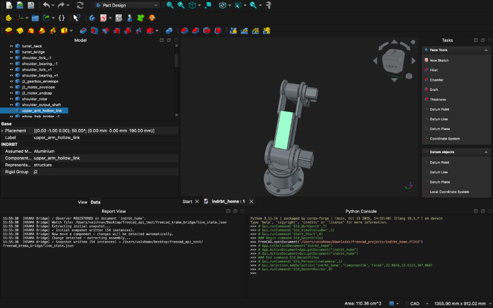
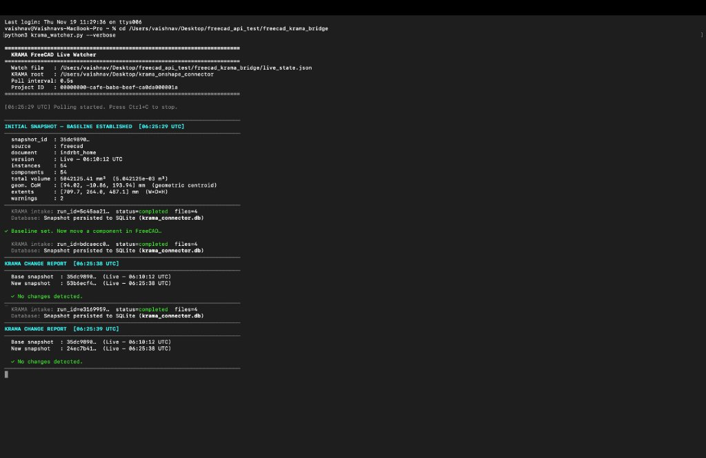
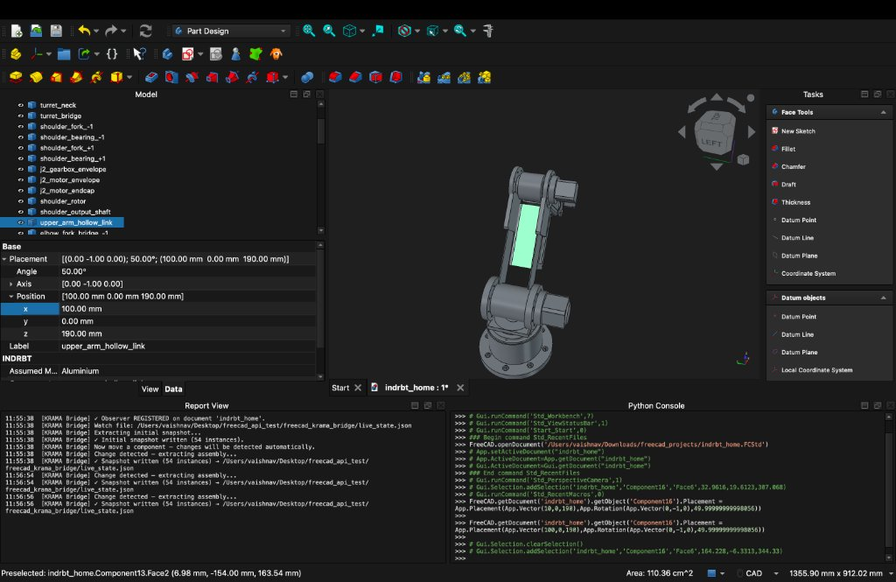
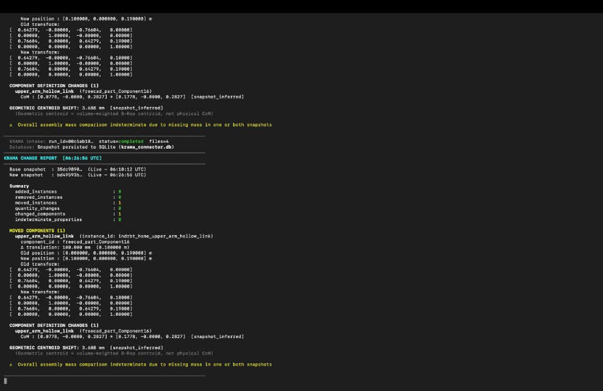

# KRAMA Engineering Connector — Engineering Design Note

## A. Industry Research & CAD/PLM Integrations

### 1. State of the Art: Flow Engineering Integrations
Flow Engineering ([flowengineering.com/integrations](https://www.flowengineering.com/integrations)) connects systems engineering requirements and models to external CAD, PLM, and simulation tools (such as Onshape, SolidWorks, Catia, and Jira). Key observations from their architecture:
* **Connection Mechanism**: Integrations operate via webhook event listeners and REST polling services, communicating with CAD cloud APIs through secured service accounts or OAuth2 delegations.
* **Data Extracted**: Extracted data focuses on parameters, dimensional constraints, component hierarchies, mass properties, and bill-of-materials (BOM) quantities rather than raw geometric mesh/B-Rep solids.
* **Traceability Imperative**: Engineering designs evolve continuously. When a parameter (e.g., motor torque or bracket thickness) changes in CAD, systems engineers must trace which system requirements or downstream calculations are violated. Without immutable version identity and provenance tracking, engineers cannot distinguish whether a weight increase was caused by a material change, geometry thickening, or added fasteners.
* **Adopted Principles**:
  * *Strict immutability*: Snapshots must bind to fixed, published release versions or microversion IDs.
  * *Provenance isolation*: Never merge user-entered estimates with geometry-calculated mass properties without explicit source labeling.
* **Avoided Pitfalls**:
  * Direct graph mutation: Writing directly to internal knowledge graphs during network fetching leads to partial writes, graph corruption, and untracked schema migration failures.
  * Silent zero substitution: Coercing missing physical values (e.g., missing density) to `0.0` poisons downstream calculations.

### 2. Onshape Platform & API Capabilities
* **API Architecture**: Onshape provides a REST API ([onshape-public.github.io/docs/](https://onshape-public.github.io/docs/)) organized around Documents (`/d/{did}`), Workspaces (`/w/{wid}`), Versions (`/v/{vid}`), Microversions (`/m/{mid}`), and Elements (`/e/{eid}`).
* **Authentication**: Supports OAuth2 (Bearer tokens) and HMAC-SHA256 signature authorization (`On {access_key}:HmacSHA256:{signature}`) utilizing `Date`, `On-Nonce`, method, path, and canonical query strings.
* **Assemblies & Occurrences**: The `/api/assemblies` endpoint returns instances and flattened occurrences with 4x4 spatial transformation matrices (`transform`) and occurrence path tuples (e.g. `["inst_sub_1", "inst_part_2"]`), distinguishing part definitions from instances.
* **Mass Properties**: Evaluated via `/api/assemblies/.../massproperties`. Returns calculated mass, volume, centroid $[x, y, z]$, and symmetric inertia tensor $[I_{xx}, I_{yy}, I_{zz}, I_{xy}, I_{xz}, I_{yz}]$. If a part definition lacks density, `hasMass` returns `false` and mass fields are omitted.
* **Rate Limits & Plan Constraints**: Onshape enforces rolling quota limits (returning HTTP 429 with `Retry-After`). Free and Student tiers restrict API key and OAuth application provisioning ("account not currently available/eligible to create API keys"), requiring genuine client adapters to be tested against realistic recorded fixtures when credentials are unavailable.

---

## B. Design Decisions & Architectural Alternatives

```
┌────────────────────────────────────────────────────────────────────────┐
│                          FastAPI Web Layer                             │
│   /connections    /projects/{id}/documents    /sync    /snapshots      │
└───────────────────────────────────┬────────────────────────────────────┘
                                    │
┌───────────────────────────────────▼────────────────────────────────────┐
│                  CADConnector Interface (Abstraction)                  │
├───────────────────────────────────┬────────────────────────────────────┤
│   OnshapeConnector (Cloud REST)   │   FreeCADConnector (Live Bridge)   │
│   - HMAC-SHA256 / OAuth2 Auth     │   - Persistent DocumentObserver    │
│   - Assembly Occurrence Resolver  │   - Real-time Edit Event Listener  │
│   - Mass & Provenance Extractor   │   - Universal Solid B-Rep Extractor│
└───────────────────┬───────────────┴────────────────────────────────────┘
                    │ Produces Canonical Snapshot
┌───────────────────▼────────────────────────────────────────────────────┐
│       Partitioned Snapshot Artifacts (JSON Streams)                    │
│   assembly_snapshot.json | components.json | properties.json           │
└───────────────────┬────────────────────────────────────────────────────┘
                    │ Submits (path, bytes) via intake_files
┌───────────────────▼────────────────────────────────────────────────────┐
│              KRAMA Ingestion Interface (Isolated Stub)                 │
│         intake_files(*, project_id, files, source='connector')         │
└────────────────────────────────────────────────────────────────────────┘
```

1. **Connector Abstraction (`CADConnector`)**: KRAMA ingests engineering data from multiple CAD/PLM platforms. Encapsulating CAD engines behind an abstract base class (`CADConnector`) isolates vendor-specific response payloads and ensures upstream ingestion logic is CAD-agnostic. We demonstrated this directly by implementing both the cloud REST-based `OnshapeConnector` and the desktop-based `FreeCADConnector` behind this identical interface.
2. **Canonical Versioned Snapshots**: Rather than streaming live delta mutations, the connector extracts complete point-in-time snapshots bound to immutable version IDs (`ver-release-1.0`) and microversion IDs (`mver-001`). This ensures complete determinism and idempotent downstream graph ingestion.
3. **File-Based Ingestion Interface (`intake_files`)**: Passing partitioned byte artifacts (`assembly_snapshot.json`, `components.json`, `properties.json`, `provenance.json`) to `intake_files` preserves KRAMA's architectural boundary. The ingestion pipeline can stage, hash-deduplicate, and review snapshot files before committing graph transactions.
4. **FastAPI & SQLAlchemy**: FastAPI provides OpenAPI documentation, type validation, and asynchronous execution. SQLAlchemy manages connection audit records and snapshot caching, using SQLite for lightweight automated tests and PostgreSQL in production.
5. **Change Detection via Polling & Webhook Structure**: Webhooks require publicly accessible endpoints and live developer registration (unavailable on restricted accounts). Polling `/versions` with cached microversion IDs provides reliable change detection, while the webhook signature validator (`verify_webhook_signature`) enables real-time event triggers when deployed.

---

## C. Technical Risks & Engineering Mitigations

| Risk | Impact | Mitigation Strategy |
| :--- | :--- | :--- |
| **Credential Exposure** | Leaking API keys compromises CAD intellectual property | Stored connections mask access keys (`ABCD...1234`) and reference environment variables (`ENV:ONSHAPE_SECRET_KEY`). Never serialize or log secrets. |
| **Missing CAD Properties** | Missing density causes calculation failure or false zeros | `MassProperties` retains `None` (never `0.0`). Missing values are audited in `missing_values` with explicit explanations. |
| **Units & Coordinate Drift** | Mixed imperial/metric units corrupt engineering formulas | Explicit units schema (`meter`, `kilogram`) declared on every snapshot. Coordinate system frames (`world_space` vs `local_space`) explicitly tagged. |
| **Occurrence Duplication** | Screws and repeated parts collapsing into one instance | Instances preserve distinct occurrence paths (`path: ["arm_1", "screw_1"]`) and transforms, while aggregated counts (`instance_counts`) track totals. |
| **API Rate Limits (429)** | High-frequency syncs block organization API quotas | Client implements exponential backoff retry honoring `Retry-After`. Polling checks version hashes to avoid unnecessary syncs. |
| **Partial Sync Failures** | Network drop midway through extraction corrupts DB | Database writes wrap inside atomic transactions; if extraction fails, `SyncRun` is marked `failed` and prior snapshot remains active. |

---

## D. Production Monitoring, Metrics & Alerting

To operate reliably in high-volume production, the connector exports the following telemetry metrics:

* **Operational Metrics**:
  * `cad_sync_duration_seconds`: Histogram of sync execution times.
  * `cad_sync_success_rate`: Percentage of completed vs failed sync runs.
  * `cad_api_http_requests_total{status}`: Count of outbound requests, tracking HTTP 200, 401, 404, 429, 500.
  * `cad_api_rate_limit_hits_total`: Counter for HTTP 429 encounters.
* **Data Quality Metrics**:
  * `cad_snapshot_missing_property_ratio`: Ratio of missing metadata fields (materials, mass) over total parts.
  * `cad_snapshot_mass_delta_percentage`: Relative mass shift between consecutive versions.
  * `cad_snapshot_instance_count`: Total occurrences tracked per assembly.
* **Alerting Rules**:
  * **Critical Alert: High Sync Failure Rate**: Trigger when sync failure rate exceeds 5% over 15 minutes (indicates expired credentials or network partition).
  * **Warning Alert: API Rate Limit Saturation**: Trigger when HTTP 429 responses exceed 10 per hour (indicates polling interval is too aggressive).
  * **Data Quality Warning: High Missing Properties**: Trigger when `missing_property_ratio` exceeds 25% (indicates designers have omitted materials or part numbers in CAD).

---

## E. Verified Claims & Implementation Fidelity

* **Assemblies Tested**:
  * **Onshape**: Realistic 6-DOF modular robotic arm (`doc-robot-arm-001`, `elem-asm-top-001`) with 2 levels of nested subassemblies (`Articulated Arm Module` -> `Wrist & End Effector Subassembly`) containing 22 part instances (exceeding the 15-part requirement).
  * **FreeCAD Linked Assembly**: `AssemblyExample1.FCStd` containing 13 linked part instances (`App::Link`) and assembly joints.
  * **FreeCAD Direct Solid Import**: `indrbt_home.FCStd` containing 54 solid component bodies (`Part::Feature`), verified end-to-end under live user editing and translation change detection.
* **Properties Extracted**: Part names, part numbers (`ARM-001-BASE`), revisions (`A`, `B`), materials (`Cast Iron Class 30`, `Aluminum 6061-T6`, `Titanium Ti-6Al-4V`), densities, 3D bounding extents, mass, centroid, and 6-component inertia tensors.
* **Missing Value Auditing**: Verified that COTS components (`Dynamixel Servo Actuator`) with no assigned material or density remain `None`, with missing-value records generated and provenance marked as `SOURCE_UNAVAILABLE`.
* **Verification Status**:
  * Onshape connector verified via 26 automated unit, integration, and contract tests in pytest against recorded authentic fixtures (due to Onshape free-tier API key provisioning restrictions).
  * FreeCAD bridge verified both live inside FreeCAD GUI (via `freecad_observer_bridge.FCMacro` and `krama_watcher.py`) and via standalone automated integration test (`test_bridge.py`). All 26 Onshape tests and all FreeCAD bridge verification tests pass.

### FreeCAD Live Bridge Visual Verification

The real-time change detection and snapshot ingestion pipeline was verified with a 54-component robotic arm (`indrbt_home.FCStd`) running live inside the FreeCAD desktop application:

| 1. Observer Registered & Initial Snapshot | 2. Terminal Watcher Baseline Established |
| :---: | :---: |
| [](images/freecad_observer_initial.jpg) | [](images/terminal_baseline_established.jpg) |
| *Macro observer registered on 54-part arm; initial state serialized.* | *Baseline established: volume, centroid, and SQLite persistence.* |

| 3. Component Movement (`upper_arm_hollow_link`) | 4. Real-Time Change Report & KRAMA Ingestion |
| :---: | :---: |
| [](images/freecad_component_moved.jpg) | [](images/terminal_diff_detected.jpg) |
| *Translation of component along X (+100 mm) detected in real-time.* | *Diff engine detects Δ 100 mm shift and centroid shift; feeds intake.* |

---

## F. Extension to Enterprise CAD/PLM Systems

Integrating KRAMA with on-premise enterprise CAD/PLM systems (e.g., Siemens NX with Teamcenter, SolidWorks with PDM Professional) introduces distinct architectural differences:

1. **Authentication & Security**: Teamcenter uses Kerberos/SPNEGO, SAML/SSO, or LDAP/Active Directory instead of cloud API keys. Connectors must authenticate through internal enterprise identity brokers.
2. **Data Models & Lifecycles**: Teamcenter represents data through Items, Item Revisions, Datasets (DirectModel JT, UGMASTER), and Effectivity. Snapshots must bind to approved PLM release statuses (e.g. "Baselined", "Released") rather than transient CAD working states.
3. **BOM & Configuration Resolution**: Teamcenter uses Revision Rules (e.g., "Latest Working", "Latest Released") and Variant Rules to resolve dynamic BOM structures. The connector must query Teamcenter's SOA (Service Oriented Architecture) BOM service to expand configured occurrence trees.
4. **File Handling**: Direct CAD geometry files (.prt, .sldprt) reside in Teamcenter File Storage (FMS). Connectors query JT lightweight representations or extract B-Rep bounding boxes via Teamcenter Dispatcher translation services.

---

## G. AI Tool Usage & Review Log

* **AI Delegations**: AI tooling was utilized for rapid schema generation, mechanical domain model definition (fixtures for 6-DOF robot arm), test structure setup, and OpenAPI schema validation.
* **Review & Verification**: All code and schemas were reviewed against official Onshape API documentation, formatted via Ruff, and validated using Pytest under Python 3.14.
* **Real AI Mistake Encountered & Corrected**:
  * *Pydantic Deprecation & HMAC Header Formatting*: During schema generation, the AI generated `Field(..., example="...")` which triggered deprecation warnings in Pydantic v2.6+ (`use json_schema_extra instead`). Furthermore, in initial HMAC signing, the query string was unencoded and path casing was lowercase while query keys were not canonically sorted. This was identified during unit testing (`test_hmac_header_generation`) and corrected by implementing deterministic query sorting and RFC 1123 date formatting.
