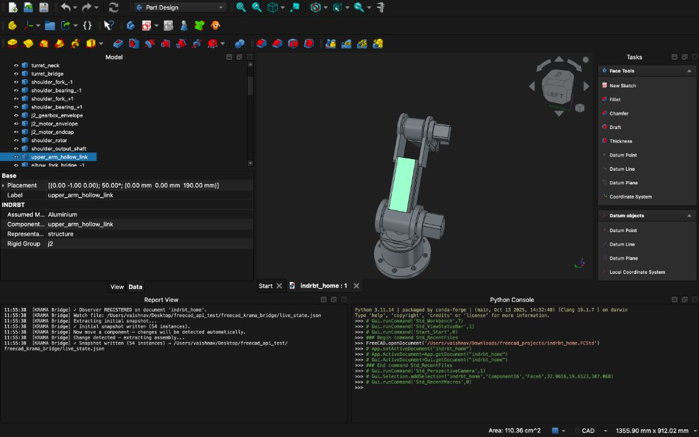
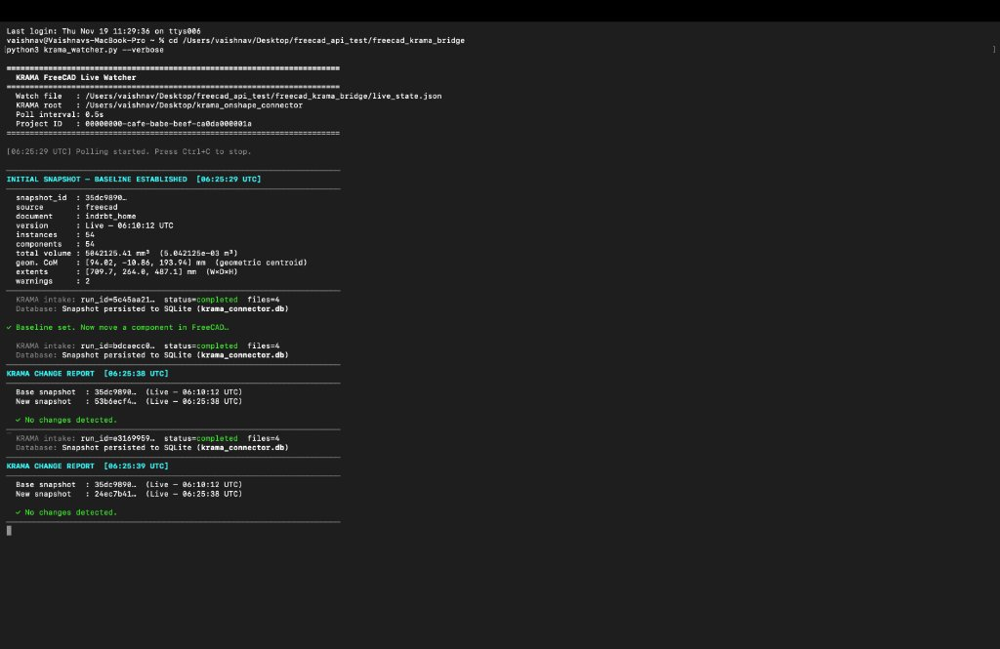
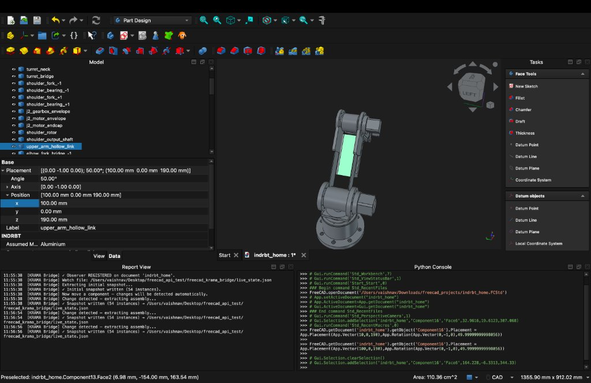
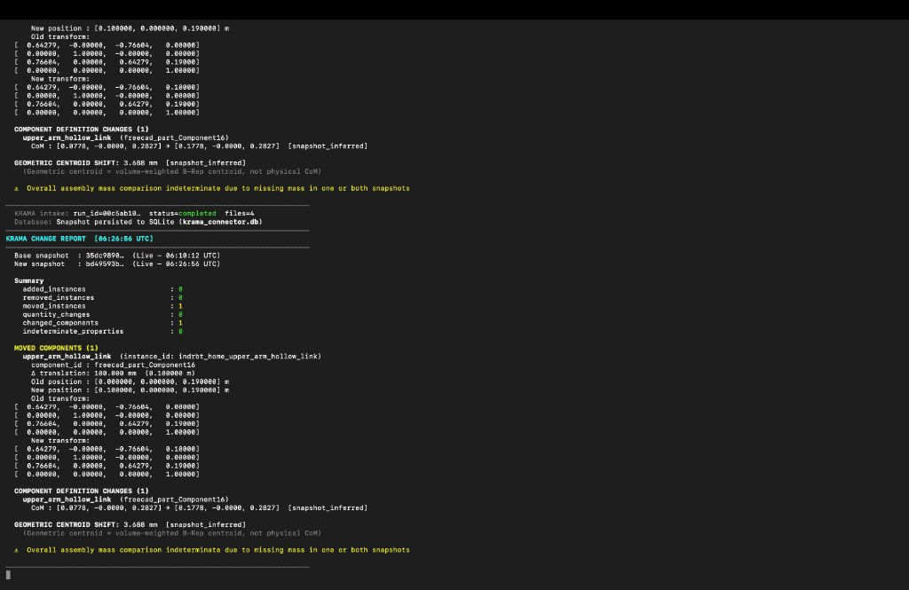

# FreeCAD → KRAMA Live Bridge

Connects the running **FreeCAD** application to the existing **KRAMA**
connector as a live CAD source. No separate FreeCAD REST API, no manually
edited JSON, no scripted movements.

---

## Architecture

```
┌─────────────────────────────────────────────────────────────────────────┐
│  FreeCAD.app (macOS)                                                    │
│                                                                         │
│  ┌────────────────────────────────────────────────────────────────┐     │
│  │  freecad_observer_bridge.FCMacro  (runs inside FreeCAD Python) │     │
│  │                                                                 │     │
│  │  Registers KramaDocumentObserver via FreeCAD.addDocumentObserver│     │
│  │                                                                 │     │
│  │  slotChangedObject / slotCreatedObject / slotDeletedObject /    │     │
│  │  slotRecomputedDocument  → fires on every user edit             │     │
│  │                                                                 │     │
│  │  Debounced (0.35 s) → run_extraction(doc)                       │     │
│  │                                   ↓                             │     │
│  │  Atomic write → live_state.json.tmp → os.replace()              │     │
│  └────────────────────────────────────────────────────────────────┘     │
└─────────────────────────────────────────────────────────────────────────┘
                              │
                     live_state.json  (watch file)
                              │
┌─────────────────────────────────────────────────────────────────────────┐
│  Normal terminal (outside FreeCAD)                                      │
│                                                                         │
│  krama_watcher.py  (polls live_state.json via os.stat every 0.5 s)    │
│                                                                         │
│  ┌────────────────────────────────────────────────────────────────┐     │
│  │  FreeCADConnector (implements CADConnector)                    │     │
│  │    reads live_state.json → KRAMA Snapshot                      │     │
│  │    converts mm → m in all transforms and bounding boxes         │     │
│  └────────────────────────────────────────────────────────────────┘     │
│                              ↓                                          │
│  ┌────────────────────────────────────────────────────────────────┐     │
│  │  SnapshotDiffEngine.compare(baseline, new_snap)                │     │
│  │  (krama_onshape_connector/app/services/diff_service.py)        │     │
│  └────────────────────────────────────────────────────────────────┘     │
│                              ↓                                          │
│  ┌────────────────────────────────────────────────────────────────┐     │
│  │  intake_files()   → IngestionRun                               │     │
│  │  (krama_onshape_connector/app/ingestion/intake.py)             │     │
│  └────────────────────────────────────────────────────────────────┘     │
│                              ↓                                          │
│       Human-readable change report printed to terminal                  │
└─────────────────────────────────────────────────────────────────────────┘
```

---

## Files

| File | Location | Purpose |
|------|----------|---------|
| `freecad_observer_bridge.FCMacro` | `freecad_krama_bridge/` | Runs inside FreeCAD; registers persistent observer (change, create, delete, undo, redo) |
| `freecad_connector.py` | `freecad_krama_bridge/` | Implements `CADConnector`; maps FreeCAD JSON → KRAMA Snapshot (mm → m, mm³ → m³) |
| `krama_watcher.py` | `freecad_krama_bridge/` | Polls `live_state.json`; runs diff engine; feeds `intake_files()`; prints reports |
| `test_bridge.py` | `freecad_krama_bridge/` | Standalone automated test suite verifying extraction, diff, and ingestion |
| `live_state.json` | `freecad_krama_bridge/` | Auto-generated atomically by the macro on every document change |

---

## Standalone Verification (No GUI Required)

To verify the complete bridge pipeline without opening FreeCAD:

```bash
cd /Users/vaishnav/Desktop/freecad_api_test/freecad_krama_bridge
python test_bridge.py
```

This verifies snapshot extraction, 10 mm component translation diffing, and KRAMA `intake_files()` ingestion.

---

## KRAMA Change (the only modification)

**File:** `krama_onshape_connector/app/schemas/snapshot.py`  
**Line 39:** `source: Literal["onshape", "freecad"] = "onshape"`

This is an additive extension; default is unchanged; all 26 existing tests pass.

---

## How to Run the Live Demo

### Visual Demonstration: Real-Time FreeCAD → KRAMA Change Ingestion

| 1. FreeCAD Observer Hook & 54-Part Arm | 2. Terminal Watcher Baseline Established |
| :---: | :---: |
| [](../../docs/images/freecad_observer_initial.jpg) | [](../../docs/images/terminal_baseline_established.jpg) |
| *FreeCAD GUI: DocumentObserver registered on 54-part arm (`indrbt_home.FCStd`), initial snapshot written.* | *Terminal Watcher: Baseline established (54 parts, volume & centroid computed, persisted to SQLite).* |

| 3. Live Component Movement (`upper_arm_hollow_link`) | 4. Real-Time Change Report & KRAMA Intake |
| :---: | :---: |
| [](../../docs/images/freecad_component_moved.jpg) | [](../../docs/images/terminal_diff_detected.jpg) |
| *FreeCAD GUI: Moving `upper_arm_hollow_link` by +100 mm along X triggers real-time debounce & atomic write.* | *Terminal Watcher: Instant Δ 100 mm translation detected, 3.688 mm centroid shift calculated, and intake completed.* |

---

### Step 1 — Start the KRAMA Watcher (normal terminal)

```bash
cd /Users/vaishnav/Desktop/freecad_api_test/freecad_krama_bridge
python krama_watcher.py
```

Options:
```
--poll-interval 0.5    # check frequency in seconds (default 0.5)
--rebaseline           # treat every change as the new baseline
--verbose              # print full 4×4 transform matrices
```

The watcher will print `Waiting…` until FreeCAD writes the first file.

---

### Step 2 — Open FreeCAD and load any assembly

Open FreeCAD (double-click `/Applications/FreeCAD.app`), then open any model:

* **Linked Assembly**: `AssemblyExample1.FCStd` (13 instances via `App::Link`)
* **Direct Solid Import**: `indrbt_home.FCStd` (54 components via `Part::Feature`) or any other STEP/IGES model.

---

### Step 3 — Run the observer macro (once)

In FreeCAD:

```
Macro → Macros… → Browse…
Navigate to: /Users/vaishnav/Desktop/freecad_api_test/freecad_krama_bridge/
Select: freecad_observer_bridge.FCMacro
Click: Execute
```

You should see in FreeCAD's Report View:

```
[KRAMA Bridge] ✓ Observer REGISTERED on document 'AssemblyExample1'.
[KRAMA Bridge] Watch file: .../live_state.json
[KRAMA Bridge] ✓ Initial snapshot written (13 instances).
[KRAMA Bridge] Now move a component — changes will be detected automatically.
```

And in your terminal the watcher will print the **INITIAL SNAPSHOT** baseline.

---

### Step 4 — Move a component (manual, in FreeCAD)

1. In the 3D view, click any part (e.g. `BasePin001`)
2. Use **Transform** (right-click → Transform) or drag in Assembly workbench
3. Move it by any amount

FreeCAD fires `slotChangedObject` automatically.  
After the 350 ms debounce, the bridge writes a new `live_state.json`.  
The watcher detects the `mtime` change and runs the diff engine.

---

### Step 5 — Read the KRAMA change report

The terminal will print something like:

```
────────────────────────────────────────────────────────────────────────
KRAMA CHANGE REPORT  [23:35:42 UTC]
────────────────────────────────────────────────────────────────────────
  Base snapshot  : a3f1c7d2…  (Live – 23:35:10 UTC)
  New snapshot   : 9e2b4f8a…  (Live – 23:35:41 UTC)

  Summary
    added_instances                    : 0
    removed_instances                  : 0
    moved_instances                    : 1
    quantity_changes                   : 0
    changed_components                 : 1
    indeterminate_properties           : 1

  MOVED COMPONENTS (1)
    BasePin001  (instance_id: AssemblyExample1_BasePin001)
      component_id : freecad_part_Shape012
      Δ translation: 50.000 mm  (0.050000 m)
      Old position : [-0.206517, 0.040256, 0.364268] m
      New position : [-0.206517, 0.040256, 0.414268] m

  GEOMETRIC CENTROID SHIFT: 2.419 mm  [snapshot_inferred]
    (Geometric centroid = volume-weighted B-Rep centroid, not physical CoM)
────────────────────────────────────────────────────────────────────────
```

---

### Stop the observer (optional)

Run the macro a **second time** to unregister the observer:

```
Macro → Macros… → freecad_observer_bridge.FCMacro → Execute
```

Report view will show:  
`[KRAMA Bridge] ✗ Observer UNREGISTERED. Bridge is now inactive.`

---

## Unit Conversions

| Quantity | FreeCAD internal | KRAMA canonical |
|----------|-----------------|-----------------|
| Length | millimetre (mm) | metre (m) |
| Volume | mm³ | m³ |
| Transform translation | mm (cols 3,7,11 of 4×4) | m |
| Angle (Euler display) | degree | — (quaternion stored) |
| Mass | ⚠ unavailable | None (no density assigned) |

**Important distinction:**  
`center_of_mass` in KRAMA MassProperties holds the **geometric centroid**
(volume-weighted B-Rep centroid of the solid shape), NOT a physical centre
of mass. Physical CoM requires density, which FreeCAD does not assign by
default. All mass-related diff results are classified `INDETERMINATE`.

---

## Observer Events

| FreeCAD Event | Trigger | Signature Dispatch |
|---------------|---------|-------------------|
| `slotChangedObject` | Any property change — position, angle, geometry | `(obj, prop)` |
| `slotCreatedObject` | New part added to assembly | `(obj)` |
| `slotDeletedObject` | Part removed from assembly | `(obj)` |
| `slotRecomputedDocument` | End of a batch recompute cycle | `(doc)` |
| `slotUndoDocument` | Undo operation in FreeCAD | `(doc)` |
| `slotRedoDocument` | Redo operation in FreeCAD | `(doc)` |

All callback methods use safe variable arguments (`*args, **kwargs`) and verify document ownership to prevent runtime type exceptions during complex modeling workflows. Events are **debounced at 350 ms** so interactive operations (like mouse dragging or multi-step recomputes) result in a single clean snapshot.

---

## Troubleshooting

| Symptom | Fix |
|---------|-----|
| Watcher prints "Watch file not found yet" | Run the macro in FreeCAD first |
| FreeCAD Report View shows "No active document" | Open AssemblyExample1.FCStd before running the macro |
| Diff shows no moved_instances after moving a part | The part may need a **Recompute** (`Edit → Refresh`) to trigger a placement change event |
| `ModuleNotFoundError: No module named 'app'` | Run `krama_watcher.py` from the bridge directory; it sets `sys.path` automatically |
